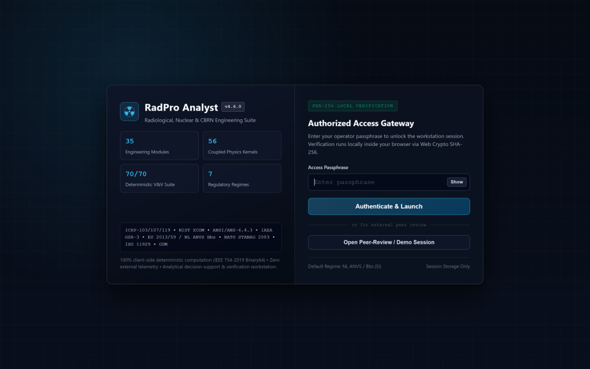
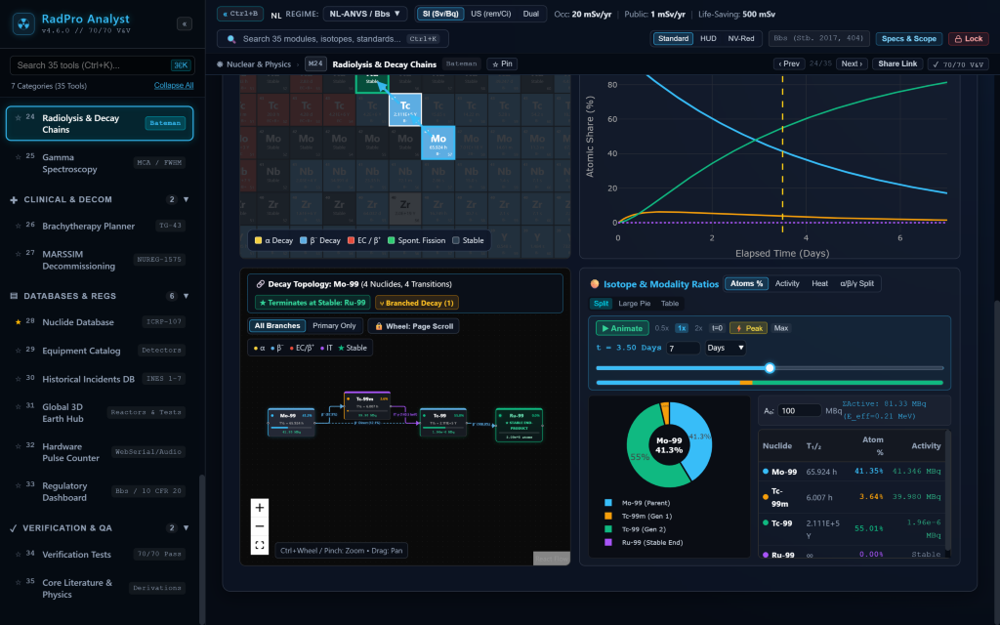
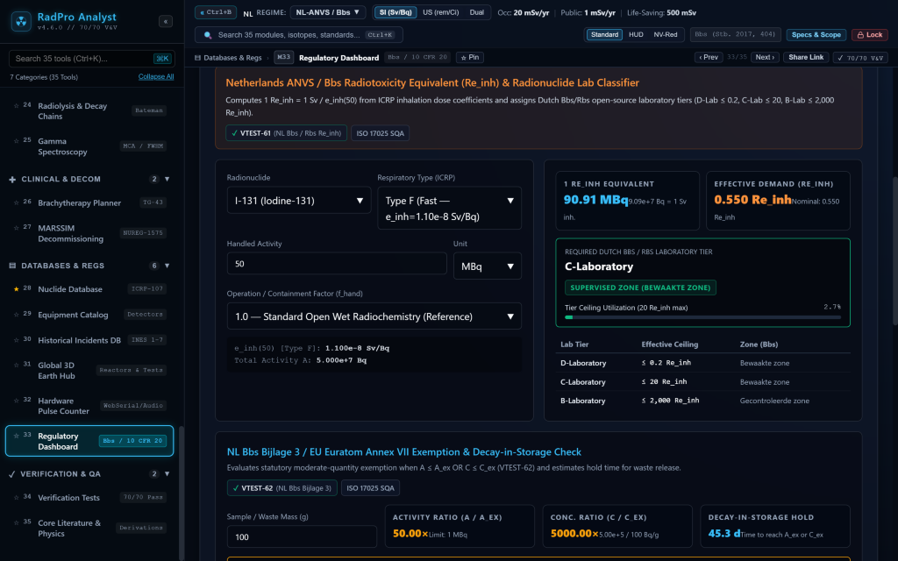
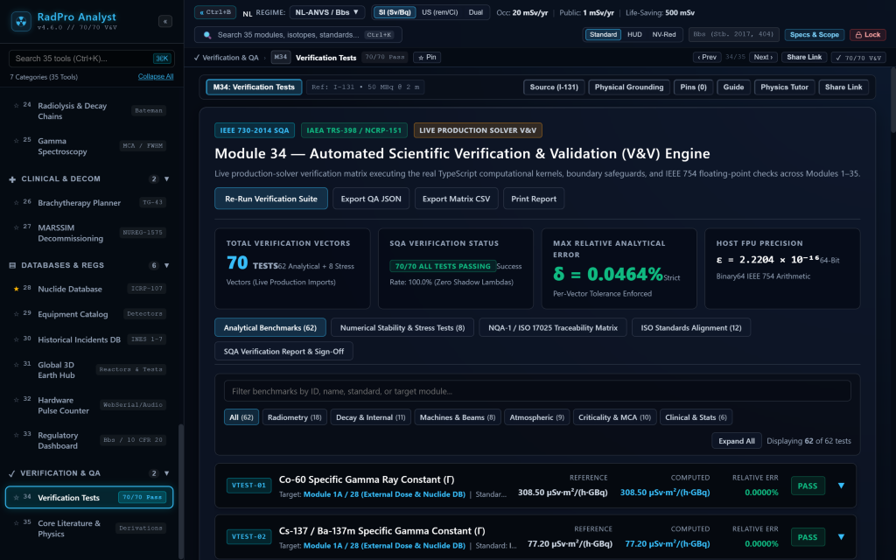

# RadPro Analyst `v4.6.0`

[](https://github.com/travisrcarlson/rad-pro-calc/actions/workflows/ci.yml)
-10b981)


**Deterministic Radiological, Nuclear & CBRN Engineering Workstation**

RadPro Analyst is an offline-capable, browser-native scientific computing suite designed for health physicists, radiation protection officers (*Stralingsbeschermingsdeskundigen* / RSOs / CHPs), radiochemistry laboratories, and defense CBRN consequence analysts. Every calculation executes locally in IEEE 754-2019 Binary64 double precision with zero external telemetry and full analytical verification traceability.

- **Live Review Build (GitHub Pages):** `https://travisrcarlson.github.io/rad-pro-calc/` *(once GitHub Pages is enabled in repository settings via Actions)*
- **Editorial & Peer-Review Brief:** [`docs/PUBLICATION_BRIEF.md`](docs/PUBLICATION_BRIEF.md)
- **Default Regulatory Baseline:** **Netherlands ANVS / Bbs** (*Besluit basisveiligheidsnormen stralingsbescherming*, Stb. 2017, 404 / EU 2013/59/Euratom, SI units) — switchable live across 7 statutory regimes.

---

## Core Engineering Highlights

- **35 Integrated Modules (`0` external backend dependencies):** External/internal dosimetry, broad-beam point-kernel and Monte Carlo shielding, bifurcating TR-BDF2 Bateman decay chains & Karlsruhe nuclide chart, 3D room ALARA tracking, atmospheric Gaussian dispersion, pulsed X-ray/laser/EMR non-ionizing safety, criticality & CAAS, MARSSIM survey design, brachytherapy TG-43U1, IAEA SSR-6 transport packaging, and CBRN tactical GIS.
- **56 Coupled Physics Kernels (`src/utils/radiologicalPhysicsKernels.ts`):** Pure TypeScript analytical and numerical solvers directly shared between all 35 UI modules and the automated V&V suite (`0` orphaned kernels).
- **70/70 Deterministic V&V Suite (`VTEST-01`–`VTEST-62` + `STRESS-01`–`STRESS-08`):** Reproducible in ~1 second from CLI (`npm test`) or interactively in Module 34 (`/verify`). Directly imports production TypeScript solvers (zero shadow lambdas), holding maximum relative analytical error to **δ = 0.0464%**.
- **Netherlands ANVS / Bbs Laboratory Toolkit:** Built-in **$Re_{\text{inh}}$ Radiotoxicity Equivalent** D/C/B-Laboratory classifier (`VTEST-61`), **Bijlage 3 / EU Euratom Annex VII Table B** moderate-quantity exemption & decay-in-storage hold-time calculator (`VTEST-62`), and one-click **TU Delft Level 4A** worked scenarios in Module 33 (`/reg`).
- **PWA Offline Readiness & Audit Dossiers:** Dynamic `dist/precache-manifest.json` background worker caching, `navigator.onLine`-resilient operation, three display modes (Standard, Tactical HUD, Night-Vision Red), and SHA-256 sealed calculation dossiers (`.radproj` / HTML print export).

---

## Visual Overview

| Entry Console & Gateway | Decay Chains, Scrubber & Karlsruhe Chart |
| :---: | :---: |
|  |  |

| NL ANVS / Bbs Lab (`Re_inh` & Bijlage 3) | 70/70 Scientific Verification & Validation Matrix |
| :---: | :---: |
|  |  |

Additional flagship views in [`docs/screenshots/`](docs/screenshots/): [3D Worker ALARA (`/worker`)](docs/screenshots/04-worker-3d-alara.png) and [Atmospheric Gaussian Plume (`/plume`)](docs/screenshots/05-atmospheric-plume.png).

---

## 35-Module Architecture

| Domain | Modules (Routes) | Key Governing Models & Standards |
| :--- | :--- | :--- |
| **Dosimetry & Spatial ALARA** | M01 External/Internal Dose (`/dose`), M02 3D Worker ALARA (`/worker`), M03 Internal Biokinetics (`/internal-dose`), M04 3D Spatial Cloud (`/spatial3d`), M05 2D Isodose Map (`/visualisation`) | ICRP 103/107/119 (`F/M/S` classes + wound/injection $f_1=1$), Kay-Kajiya 3D Ray-AABB, NIST XCOM + ANSI/ANS-6.4.3 GP buildup |
| **Emergency, CBRN & GIS** | M06 Tactical CBRN (`/first-responder`), M07 Fallout & Shelter (`/cbrn-consequence`), M08 Prompt Blast & HEMP (`/nuclear-weapons-effects`), M09 Medical Countermeasures (`/medical-countermeasures`), M10 Tactical GIS / CoT (`/tactical-gis`), M11 Incident Drills (`/scenarios`), M12 Reverse Triangulation (`/responder`), M13 Atmospheric Plume (`/plume`), M14 Shielding & PAGs (`/shielding`), M15 Transport (`/transport`) | ERG 2024, Way-Wigner $t^{-1.2}$, Kingery-Bulmash, DTPA/PB/KI clearance, Cursor-on-Target / KML / GeoJSON, Levenberg-Marquardt $1/r^2$, Briggs/Turner Gaussian plume + Chamberlain depletion, IAEA SSR-6 |
| **Beams, X-Ray & Non-Ionizing** | M16 Pulsed/Flash X-Ray (`/xray`), M17 X-Ray Tube (`/xray-tube`), M18 X-Ray Distortion (`/xray-distortion`), M19 Laser NOHD (`/laser`), M20 RF / EMR Safety (`/emr-safety`) | NCRP 147, Duane-Hunt + Kramers bremsstrahlung ($K$-edges W/Mo/Rh), paralyzable dead-time, ANSI Z136.1 / IEC 60825-1, FCC OET-65 / IEEE C95.1 |
| **Reactor, Decay & Medical** | M21 Criticality (`/criticality`), M22 CAAS Alarms (`/caas-criticality`), M23 Monte Carlo (`/monte-carlo`), M24 Decay Chains & Karlsruhe Chart (`/decay`), M25 Spectroscopy (`/spectroscopy`), M26 Brachytherapy (`/brachytherapy`), M27 MARSSIM Surveys (`/marssim`) | Two/four-factor criticality + Keepin inhour + Nordheim-Fuchs, ANSI/ANS-8.3, Web Worker photon transport, L-stable TR-BDF2 bifurcating DAG solver, Mariscotti $\sigma$, AAPM TG-43U1, NUREG-1575 Sign/WRS + Acklam $\Phi^{-1}(p)$ |
| **Registries, Compliance & V&V** | M28 Nuclide Table (`/nuclides`), M29 Equipment Library (`/equipment`), M30 Historical Incidents (`/incidents`), M31 Global Nuclear Atlas (`/global-map`), M32 Detector Hardware (`/hardware`), M33 Compliance & NL Bbs Lab (`/reg`), M34 Verification Matrix (`/verify`), M35 Reference Derivations & CARI-7 (`/literature`) | INES register, 2,038 global tests (8 nuclear-armed states), ISO 11929-1 / ISO 7503 / ISO 4037-3 / GUM $k=2$, NL ANVS Bbs (`Re_inh` & Bijlage 3), 7-regime concordance matrix |

---

## Regulatory & Physics Standards Register

| Standard / Data Source | Scope in RadPro Analyst |
| :--- | :--- |
| **NL ANVS / Bbs (Stb. 2017, 404) & Rbs** | Default regime (`20 mSv/yr` Cat. A, `20 mSv/yr` eye lens, `0.1 mSv/yr` MID), `Re_inh` D/C/B-Lab classifier (`VTEST-61`), Bijlage 3 exemptions (`VTEST-62`) |
| **EU 2013/59/Euratom & UK IRR17 / IAEA GSR Part 3** | Synchronized occupational, public, fetal, and emergency reference ceilings across all modules |
| **US 10 CFR Part 20 / DOE 10 CFR 835 / NATO STANAG 2083** | Switchable statutory limits, ALARA tiers, and military OEG / RES exposure guidance |
| **ICRP 103, 107, 119, 68/78 & ICRU $H^*(10)/H_p(10)$** | Specific gamma constants, inhalation (`F/M/S`), ingestion, systemic injection, and retention integrals |
| **NIST XCOM & ANSI/ANS-6.4.3 / NCRP 147 & 151** | Elemental/compound mass attenuation and Geometric Progression broad-beam buildup factors (`Pb`, `W`, `Steel`, `Concrete`, `Water`, `DU`, `Air`) |
| **IAEA SSR-6 (Rev. 1) & ADR Class 7** | $A_1/A_2$ mixture limits (`VTEST-13`) and Transport Index category (`I-WHITE` / `II-YELLOW` / `III-YELLOW`) |
| **ISO 11929-1, ISO 7503-1, ISO 4037-3, GUM (JCGM 100)** | Characteristic decision/detection limits ($L_C/L_D$), surface contamination, reference air-kerma conversion, expanded uncertainty (`VTEST-57`–`60`) |

---

## Quickstart & Verification

### Prerequisites
- **Node.js `22.x`** (`v22.18.0` tested) — required for direct `.ts` native TypeScript execution of the production physics V&V suite.

### Install & Run Locally

```bash
npm install
npm run dev
```

On the entry console, click **`Open Peer-Review / Demo Session`** for immediate evaluation access, or sign in with an operator passphrase hashed client-side via SHA-256.

### Reproducible Engineering & V&V Gates

```bash
# Strict TypeScript type-check (app + Vite config)
npx tsc -p tsconfig.app.json --noEmit
npx tsc -p tsconfig.node.json --noEmit

# Zero-warning ESLint audit
npm run lint

# Run all 70 deterministic physics & boundary stress benchmarks against production solvers
npm test

# Production Vite bundle + offline Service Worker precache manifest + 404.html SPA fallback
npm run build
```

Subpath GitHub Pages verification build:

```bash
VITE_BASE_PATH=/rad-pro-calc/ npm run build
```

---

## Deployment

- **GitHub Actions CI (`.github/workflows/ci.yml`):** Automatically runs `tsc`, `eslint`, `npm test` (`70/70`), and `npm run build` on every push and pull request.
- **GitHub Pages (`.github/workflows/pages.yml`):** Builds with `VITE_BASE_PATH=/rad-pro-calc/`, preserves deep-link SPA routing via `dist/404.html`, and keeps Service Worker asset resolution subpath-safe (`import.meta.env.BASE_URL`). To publish, set **Repository Settings → Pages → Source: GitHub Actions**.
- **Cloudflare Pages / Netlify:** Root `public/_redirects` and `public/_headers` are bundled into `dist/` automatically with `Cache-Control` and `X-Frame-Options: DENY` policies.

---

## Engineering & Regulatory Scope Disclaimer

RadPro Analyst is an analytical **decision-support, training, and independent verification workstation** implementing published physical models, consensus standards, and statutory tables. It is **not** a certified medical device, licensed licensing-basis transport code, or substitute for an accredited radiation protection authority. All operational radiation work permits, regulatory filings, source transport declarations, and clinical or emergency decisions require independent verification and formal sign-off by a qualified Radiation Protection Expert (*Stralingsbeschermingsdeskundige* SBD Level 4A/3, RSO, or CHP).
